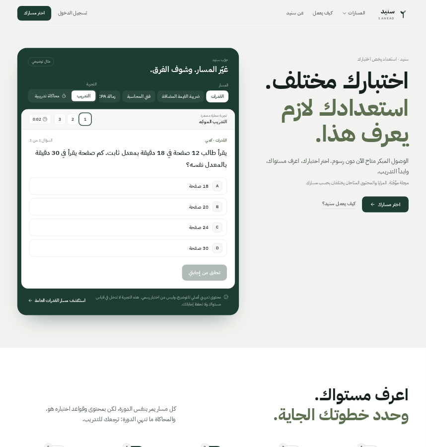

# Sanead | سنيد

**Live independent product** · [Open experience](https://sanead.com) · [Author profile](https://github.com/Abdulrahmnh)

## Business objective

Help learners prepare for professional certifications and standardized assessments through structured practice.

## Implemented or demonstrated scope

- Guided practice and exam simulations.
- Readiness and progress tracking across learning tracks.
- Product iteration, QA, release verification and performance monitoring.

## Technologies

TypeScript, web application, API, PostgreSQL, Render

## My contribution

Founder and product owner: product strategy, requirements, engineering direction, quality and releases.

## Scope and transparency

Independent SaaS product. Screenshot depicts a design prototype, not necessarily the current production UI. Proprietary code and user data remain private.

## Engineering documentation

[Architecture and verification](docs/architecture.md)

This showcase contains public-facing documentation and design imagery only; the product source remains private.
