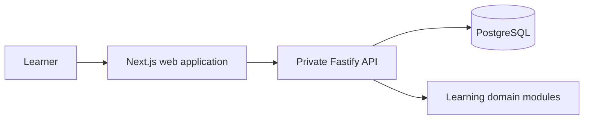

# Architecture & verification

The project uses a TypeScript monorepo, Next.js/React, Fastify and PostgreSQL. Separate web and private API services support the learner journey. Domain modules organize content, practice and readiness responsibilities.

## Quality approach

- Risk-based checks for learner navigation, practice, mock exams and saved progress.
- Type checks, contract tests, browser journeys and release verification are part of the engineering workflow.
- Deployment and performance monitoring support iterative improvement.

These are engineering practices, not a fresh test result, independent certification or guarantee of availability. Proprietary algorithms, exam material, user data and operational details remain private.
